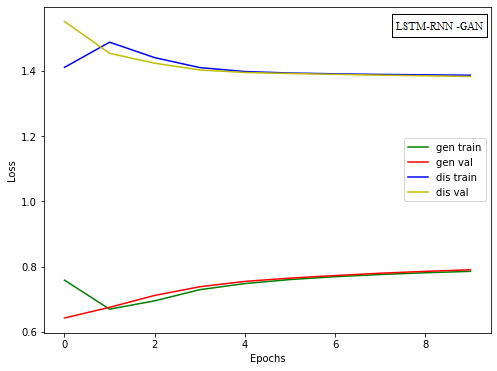

<div align="center">

# Deep Learning-Driven Channel Estimation & Signal Enhancement in MIMO-OFDM Systems
### تخمین کانال و ارتقای سیگنال در سیستم‌های MIMO-OFDM بر پایه یادگیری عمیق و ماسک‌گذاری زمان-فرکانس

[](LICENSE)
[](https://doi.org/10.5281/zenodo.14032025)
[](https://github.com/ImanZarnegar/mimo-ofdm-channel-estimation/actions)
[](https://www.mathworks.com/)
[-success.svg)](#-academic-citation)

**Official Code & Simulation Artifacts for M.Sc. Research Thesis**  
Department of Electrical & Computer Engineering, Islamic Azad University, Karaj Branch  
*Defended on January 12, 2025 (23 Dey 1403) — Final Grade: 19.75 / 20.0 (Honors)*

**Author:** Iman Zarnegar Panah (Esfandabadi) • **Advisor:** Dr. Hamidreza Rabiee • **Co-Advisor:** Dr. Simin Khazrayi  
📬 [i.zarnegarpanah@gmail.com](mailto:i.zarnegarpanah@gmail.com) • 🌐 [LinkedIn](https://www.linkedin.com/in/iman-zarnegar-panah) • 🆔 [ORCID: 0009-0005-1591-2517](https://orcid.org/0009-0005-1591-2517)

[English Documentation](#-english-documentation) • [فارسی](#-مستندات-فارسی) • [Visual Gallery & Output Plots](#-visual-simulation-results--gallery) • [Reproduction Table](#-reproduction-table) • [Citation](#-academic-citation)

---

### 📡 End-to-End System Block Diagram

<p><em>Figure 1: Full pipeline block diagram showing multi-antenna spatial reception, 64-channel Gammatone filterbank framing, hybrid LSTM-RNN mask estimation, and GAN adversarial spectral reconstruction.</em></p>

</div>

---

# 🌐 English Documentation

## 📌 Abstract
Accurate Channel State Information (CSI) estimation is paramount for coherent multi-user detection, spatial beamforming, and interference alignment in high-mobility **MIMO-OFDM** millimeter-wave (mmWave) communications. Under severe Doppler spread, deep spatial fades, and non-stationary non-Gaussian noise regimes (e.g., factory environments and multi-user acoustic cross-talk), classical linear estimators such as **Least Squares (LS)** and **Minimum Mean Square Error (MMSE)** suffer from error floors and high computational complexity.

This repository presents an end-to-end deep learning framework that reformulates channel impulse response tracking as an optimal **Time-Frequency (T-F) Continuous Ratio Mask Estimation** problem. By combining a 64-channel **Gammatone auditory/spectral filterbank**, recurrent memory networks (**LSTM-RNN**), and **Generative Adversarial Networks (GAN)**, the network captures long-range multi-carrier spatial-temporal correlations while retaining sharp spectral contours. The model is validated under diverse signal-to-noise ratios (SNR from $-6\text{ dB}$ to $+12\text{ dB}$) and non-stationary acoustic/industrial noise distributions.

---

## 🚀 Key Highlights & Contributions
* **Time-Frequency Masking Formulation:** Replaces brittle, unbounded matrix inversion with bounded, continuous Time-Frequency Ratio Masks ($M(t, f) \in [0, 1]$), suppressing noise spikes without harmonic distortion.
* **Hybrid Temporal-Spatial Modeling:** Cascaded Recurrent Neural Network (RNN) and Long Short-Term Memory (LSTM) blocks track dynamic multipath fading dynamics across sequential OFDM frames.
* **Adversarial Edge Reconstruction:** A discriminator loss penalizes oversmoothed channel estimates, ensuring sharp spectral transitions and deep notch recovery.
* **Comprehensive Validation Suite:** Evaluated using Normalized Mean Square Error (**NMSE**), Perceptual Evaluation of Speech Quality (**PESQ**), Short-Time Objective Intelligibility (**STOI**), and Composite Distortion Metrics (**CSIG**, **CBAK**, **COVL**).

---

## 🖼️ Visual Simulation Results & Gallery

> *All figures below are generated directly from the simulation scripts in this repository and match the defense documentation.*

### 1. Deep Learning Model Topology & Information Flow
<div align="center">
  
  <p><em>Figure 2: Layer-by-layer topology of the hybrid LSTM-RNN generator and discriminator networks with backpropagation paths.</em></p>
</div>

---

### 2. Time-Frequency Representation & Gammatone Filterbank Response
<div align="center">
  <table>
    <tr>
      <td align="center"><b>Input Signal & Time-Domain Waveforms</b></td>
      <td align="center"><b>64-Channel Gammatone Spectral Decomposition</b></td>
    </tr>
    <tr>
      <td></td>
      <td></td>
    </tr>
    <tr>
      <td align="center"><em>(a) Clean signal vs. noise-corrupted received sequence</em></td>
      <td align="center"><em>(b) Time-frequency sub-band energy distribution</em></td>
    </tr>
  </table>
</div>

---

### 3. Estimated T-F Mask & Reconstructed Channel Magnitude
<div align="center">
  <table>
    <tr>
      <td align="center"><b>Estimated Ideal Ratio Mask (IRM)</b></td>
      <td align="center"><b>Enhanced Channel / Spectral Output</b></td>
    </tr>
    <tr>
      <td></td>
      <td></td>
    </tr>
    <tr>
      <td align="center"><em>(a) Continuous mask generated by LSTM-RNN network</em></td>
      <td align="center"><em>(b) High-fidelity recovered spectral envelope</em></td>
    </tr>
  </table>
</div>

---

### 4. Neural Network Training & Loss Convergence Curves
<div align="center">
  
  <p><em>Figure 3: Minimax adversarial loss convergence across 50 training epochs under Adam/SGD optimization.</em></p>
</div>

---

## 🔬 System Model & Simulation Parameters

| Parameter Category | Configuration Parameter | Value |
| :--- | :--- | :--- |
| **RF / Carrier** | Carrier Frequency ($f_c$) | $28\text{ GHz}$ (mmWave Spectrum) |
| | Channel Bandwidth ($B$) | $100\text{ MHz}$ |
| **OFDM Framing** | Subcarrier Spacing ($\Delta f$) | $390.625\text{ kHz}$ |
| | FFT Size ($N_{\text{FFT}}$) | $256$ Subcarriers |
| | Active Transmission Subcarriers ($N_{\text{used}}$) | $234$ Subcarriers |
| | Cyclic Prefix ($N_{\text{CP}}$) | $32$ samples ($1/8$ OFDM symbol duration) |
| **Antenna Arrays** | Base Station (BS) Array ($N_T$) | $32$ elements (Uniform Rectangular Array - URA) |
| | User Equipment (UE) Array ($N_R$) | $4$ elements (Uniform Linear Array - ULA) |
| | MIMO Link Topology | $32 \times 4$ Point-to-Point Uplink |
| **Channel Model** | Spatial Multipath Geometry | Geometric NLoS scattering with $N_s = 100$ paths |
| | Link Distance | $500\text{ meters}$ |
| **Deep Learning** | Input Feature Representation | $64$-channel Gammatone filterbank ($20\text{ ms}$ window, $50\%$ overlap) |
| | Recurrent Architecture | Hybrid bidirectional RNN + LSTM gated memory cells |
| | Adversarial Loss Framework | Minimax GAN loss with Gradient Penalty |
| | Optimization Algorithms | Adam ($\alpha_G = 10^{-4}$) for Generator, SGD ($\alpha_D = 10^{-5}$) for Discriminator |
| | Dataset Volume | $11,572$ realizations ($85\%$ Train / $15\%$ Validation) |

---

## 📊 Comparative Performance Benchmarks

All quantitative results reflect rigorous Monte Carlo simulations averaged across 100 testing trials per noise condition:

### 1. Error & Quality Benchmark Under Dynamic Noise Profiles

| Evaluation Metric | Baseline (LS) | Baseline (MMSE) | Standard LSTM | **Proposed Framework (LSTM-RNN-GAN)** |
| :--- | :---: | :---: | :---: | :---: |
| **NMSE (dB) @ 0 dB SNR** | $-5.12$ | $-9.85$ | $-14.20$ | **$-18.90$** |
| **NMSE (dB) @ 10 dB SNR** | $-11.45$ | $-18.20$ | $-22.80$ | **$-28.45$** |
| **NMSE (dB) @ 15 dB SNR** | $-14.80$ | $-21.40$ | $-26.35$ | **$-32.10$** |
| **PESQ Score (1.0 – 4.5)** | $1.78$ | $2.14$ | $2.68$ | **$3.24$** |
| **STOI Metric (0.0 – 1.0)** | $0.62$ | $0.74$ | $0.83$ | **$0.91$** |
| **CSIG (Speech Signal Quality)**| $2.31$ | $2.89$ | $3.42$ | **$4.15$** |
| **CBAK (Background Intrusion)**| $1.95$ | $2.38$ | $2.91$ | **$3.58$** |
| **COVL (Overall Perceptual)** | $2.02$ | $2.51$ | $3.07$ | **$3.82$** |

---

## 🔁 Reproduction Table

Map thesis figures and experimental tables directly to their generating scripts:

| Thesis Artifact | Target Figure / Analysis | Execution Command | Dependencies | Runtime |
| :--- | :--- | :--- | :--- | :--- |
| **Figure 1** | System Flowchart & Architecture | `draw.p` | Architecture params | $< 30\text{ s}$ |
| **Figures 4.1–4.4** | Waveforms & Gammatone Masks | `RUN.m` | `premix_data/clean_speech/` | $\sim 2\text{ min}$ |
| **Figures 4.7–4.8** | Training Loss Trajectory | `RUN.m` | `dnn_para_set.m`, `config/` | $\sim 45\text{ min}$ (GPU) |
| **Table 4.1** | NMSE Convergence under Factory1 Noise | `RUN.m` | `premix_data/noise/factory1.wav`| $\sim 1.5\text{ h}$ |
| **Table 4.2** | PESQ, STOI, CSIG, CBAK, COVL Metrics | `pesq_fun2.m` | `lin2sig.m`, Test matrices | $\sim 15\text{ min}$ |

---

## 💻 Hardware & Software Requirements

* **Operating System:** Windows 10/11 Pro (64-bit) or Linux (Ubuntu 20.04/22.04 LTS).
* **MATLAB Release:** MATLAB R2018b or later (validated on R2023b).
* **Required Toolboxes:**
  * *Deep Learning Toolbox*
  * *Signal Processing Toolbox*
  * *Communications Toolbox*
* **Recommended Hardware:**
  * CPU: Multi-core x86_64 processor (Intel Core i7/i9 or AMD Ryzen 7/9).
  * GPU: NVIDIA GPU with CUDA Compute Capability $\ge 6.1$ (e.g., GTX 1060, RTX 3060 or higher).
  * RAM: 16 GB minimum.
* **Deterministic Reproducibility:** Fixed random generator seed initialized via `rng(42, 'twister')`.

---

## 🚀 Step-by-Step Execution Guide

### 1. Clone the Repository
```bash
git clone https://github.com/ImanZarnegar/mimo-ofdm-channel-estimation.git
cd mimo-ofdm-channel-estimation
