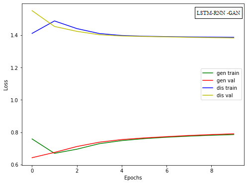
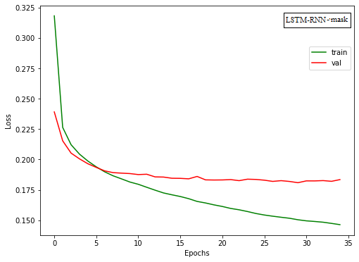
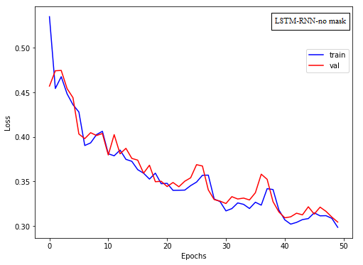
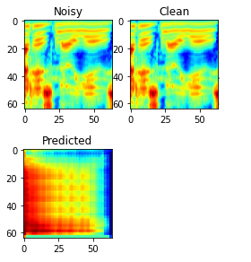
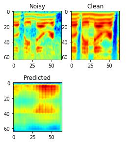
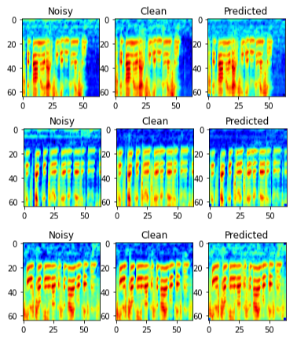
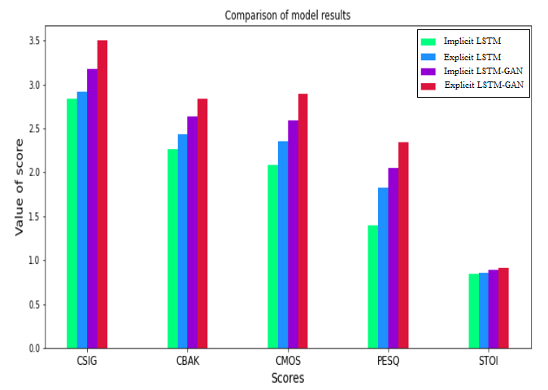

<div align="center">

# Deep Learning-Based Channel Estimation and Signal Enhancement in MIMO-OFDM Systems
### تخمین کانال و ارتقای سیگنال در سیستم‌های MIMO-OFDM با یادگیری عمیق و ماسک زمان-فرکانس

[](https://www.mathworks.com/)

**M.Sc. Thesis** — Department of Electrical & Computer Engineering, Islamic Azad University, Karaj Branch
*Dey 1403 (Jan 2025)*

**Author:** Iman Zarnegar Panah Esfandabadi • **Advisor:** Dr. Hamidreza Rabiee • **Co-Advisor:** Dr. Simin Khazraei Shoolaeifar

📬 [i.zarnegarpanah@gmail.com](mailto:i.zarnegarpanah@gmail.com) • 🌐 [LinkedIn](https://www.linkedin.com/in/iman-zarnegar-panah) • 🆔 [ORCID](https://orcid.org/0009-0005-1591-2517)

[Abstract](#abstract) • [Thesis Figures](#thesis-figures) • [Simulation Parameters](#system-model-and-simulation-parameters) • [Reproduction](#reproduction) • [Results](#results)

</div>

---

## Abstract

Accurate channel state information (CSI) estimation is needed for coherent detection and beamforming in MIMO-OFDM systems at 28 GHz. Classical baselines are Least Squares (LS) and Linear MMSE (LMMSE). LS uses no prior knowledge of the data, and LMMSE uses second-order statistics.

This work proposes a deep learning approach that formulates channel enhancement as time-frequency (T-F) mask estimation. The model combines a 64-channel Gammatone filterbank, an LSTM-RNN, and a GAN-based training scheme. The thesis compares models with and without the mask and with and without the GAN (Tables 4-1, 4-3; Figs. 4-1 to 4-5).

---

## Key Points

* **T-F mask output:** the network predicts a mask over the time-frequency representation (linear output layer, as stated in the thesis).
* **Hybrid LSTM-RNN model:** see thesis Fig. 3-2.
* **Evaluation:** the thesis reports NMSE versus SNR (Fig. 4-7) and comparison with other papers (Table 4-4).

---

## Thesis Figures

Images in `pic/` are copies of thesis figures. Figures marked "Thesis only" are not in this repository.

| Thesis figure | Content | Image |
| :--- | :--- | :--- |
| Fig. 3-1 | Proposed channel-estimation architecture | Thesis only |
| Fig. 3-2 | Hybrid LSTM-RNN model | Thesis only |
| Fig. 4-1 | Loss, LSTM-RNN-GAN with mask |  |
| Fig. 4-2 | Loss, LSTM-RNN with mask |  |
| Fig. 4-3 | Loss, LSTM-RNN without mask |  |
| Fig. 4-4 | Gammatone spectrograms (noisy / clean / predicted) |    |
| Fig. 4-5 | Mask vs. no mask, LSTM-RNN and LSTM-RNN-GAN |  |
| Fig. 4-6 | Convergence vs. NRE | Thesis only |
| Fig. 4-7 | NMSE vs. SNR (dB) | Thesis only |

---

## System Model and Simulation Parameters

| Category | Parameter | Value |
| :--- | :--- | :--- |
| RF / Carrier | Carrier frequency | 28 GHz |
| | Bandwidth | 100 MHz |
| OFDM | FFT size | 256 |
| | Used subcarriers | 234 |
| Antennas | BS array | 32 elements (URA) |
| | UE array | 4 elements (ULA) |
| | Link | 32 × 4 downlink (BS to UE) |
| Channel | Model | Geometric NLoS, 100 scatterers |
| | Distance | 500 m |
| Deep learning | Features | 64-channel Gammatone filterbank (20 ms Hamming window, 50% overlap) |
| | Optimizer | Adam (generator), SGD (discriminator) |
| | Learning rate / batch | 2×10⁻⁴ / effective batch 200 |
| | Epochs | 25 (thesis text) — see Notes |
| | Dataset | 11,572 signals (11,000 train / 572 validation) |

---

## Reproduction

| Thesis artifact | Content | Related code (not yet verified by running) |
| :--- | :--- | :--- |
| Fig. 4-1 to 4-3 | Loss curves | `RUN.m` |
| Fig. 4-5, 4-6 | Mask vs. no mask; convergence | `RUN.m` |
| Fig. 4-7 | NMSE vs. SNR | `RUN.m` |
| Table 4-1 | Metrics for normalized data | `RUN.m` |
| Table 4-2 | Normalized vs. standardized; Adam vs. SGD | `RUN.m` with changed settings |
| Table 4-3 | Activation effect | `RUN.m` with changed settings |
| Table 4-4 | Comparison with other papers | Literature values, not code |

---

## Results

Numeric results are taken from the thesis (Fig. 4-7, Tables 4-1 to 4-4). The PESQ, STOI, CSIG, CBAK and COVL metrics are not reported, because `pesq_fun2.m` is a placeholder that returns zeros.

---

## Requirements

* **OS:** Windows 10/11 (64-bit) or Linux
* **MATLAB:** R2022b
* **Toolboxes:** Deep Learning, Signal Processing, Communications
* **Hardware:** multi-core x86_64 CPU, 16 GB RAM, NVIDIA GPU recommended

---

## Getting Started

```bash
git clone https://github.com/ImanZarnegar/mimo-ofdm-channel-estimation.git
cd mimo-ofdm-channel-estimation
```

Open MATLAB and run `RUN.m`.

---

## Notes

* The thesis text gives 25 epochs, but the loss figures show different epoch counts. This is under review.
* `RUN.m` does not set a random seed. Add `rng(42)` at the top for repeatable runs.
* The PESQ code is a placeholder (see Results).
